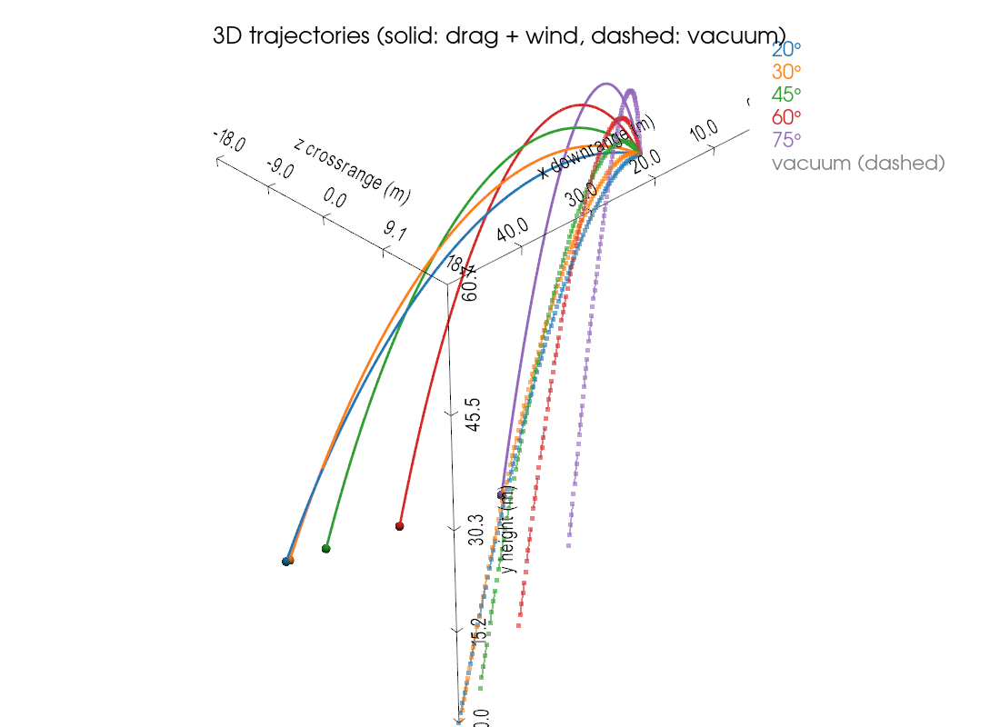

# 3D Projectile (Drone Dropper) Simulation

Predicts the ballistic trajectory of an object launched or dropped into the air, with and without drag.




## Usage

1. Edit the parameters in `Params` for your object (speed, angles, mass, area, drag coefficient, wind, release height).
2. Run the script from your terminal or IDE:

```bash
python 3D_drone_dropper.py
python 2D_drone_dropper.py
```

## Assumptions

- Constant wind
- Quadratic drag
- Exponential air density. Altitude changes little, and it takes a drastic climb for density (rho) to be significantly affected.

## Validation Checks

- **Vacuum check:** with `Cd = 0`, the numeric result matches the analytic solution
- **Angle bounds:** the optimal launch angle must not land on the edge of the search range
- **Crosswind sign:** positive and negative crosswinds push the projectile in opposite directions, and mirror each other
- **Planar symmetry (3D):** with no crosswind and zero azimuth, there is no crossrange drift
- **Drag force magnitude:** a drop from rest is compared against the analytic quadratic-drag solution
- **Temperature-Density check** on colder days, the air density should be higher

## Changelog

- Added a 3D graph
- Fixed the 3D graph
- Fixed `flight_dynamics`: corrected the drag physics and removed a possible divide-by-zero edge case
- Added the planar symmetry and crosswind sign checks
- Added the drag force checker
- Fixed temperature not affecting rho

## Goals for the future/Status of Project:
- Hiatus currently, going to be focusing on other things
- Will come back to it, with plans to add ML for more fitted datas
- Kept matplotlib in for this just in case
